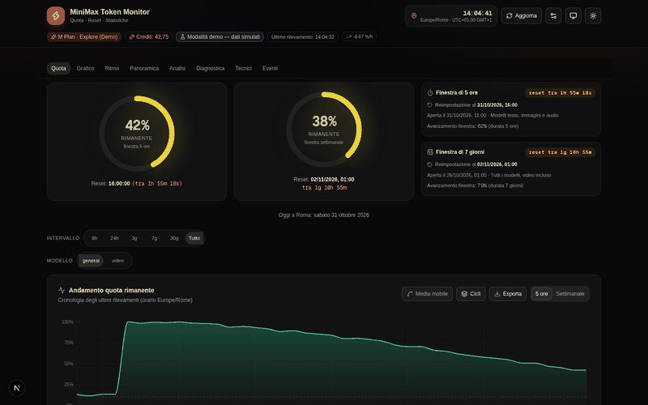
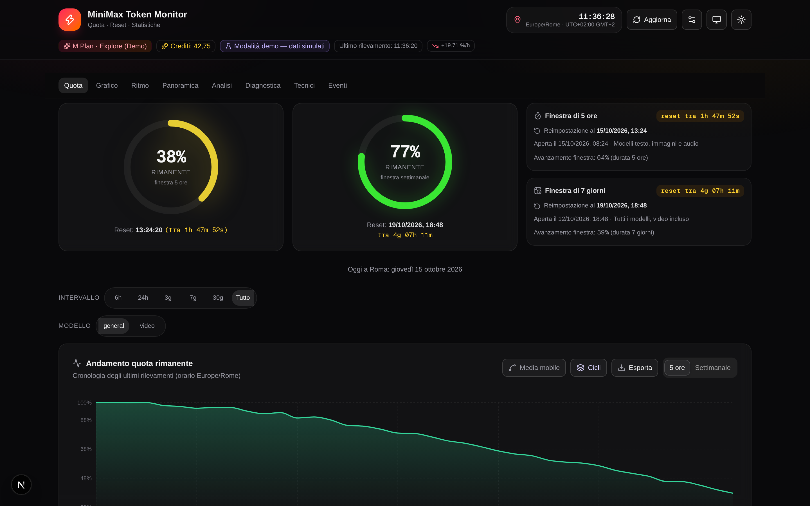
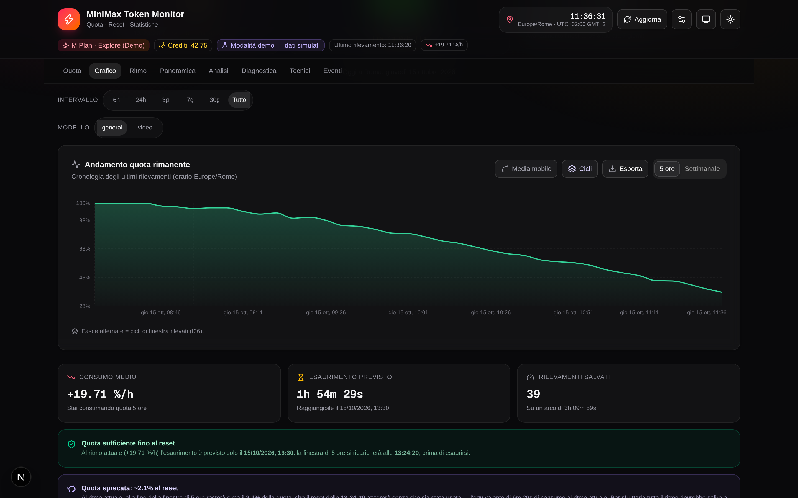
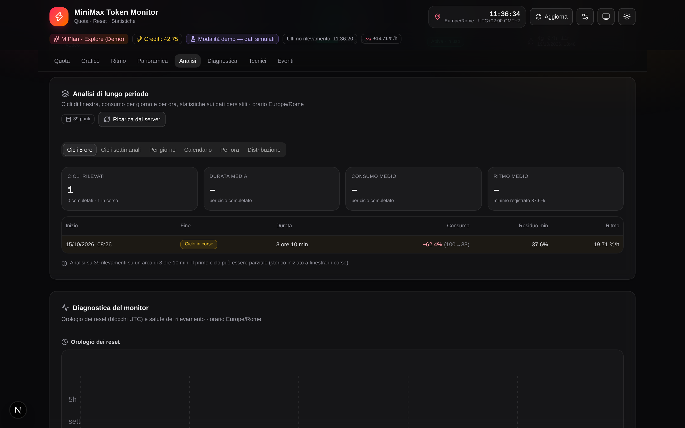
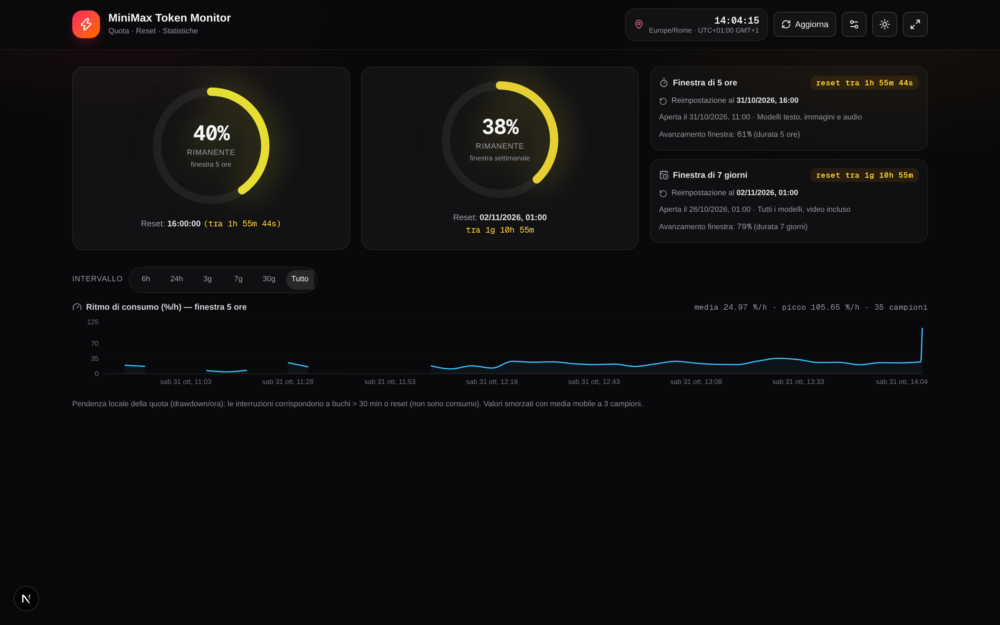

<div align="center">

# 📊 MiniMax Usage Monitor

**Dashboard in tempo reale per il piano a token MiniMax (Token Plan / M Plan) —
quote live, countdown di reset, analisi d'uso e avvisi, con tutti gli orari nel fuso Europe/Rome.**

[](https://nextjs.org)
[](https://react.dev)
[](https://www.typescriptlang.org)
[](https://tailwindcss.com)
[](https://www.prisma.io)
[](https://bun.sh)

[](https://github.com/amedeo82/MiniMax-Token-Monitor/actions/workflows/ci.yml)
[](https://minimax-token-monitor.vercel.app/)
[](tests)
[](scripts/verifiche)
[](#funzionalit%C3%A0)
[](#)

### 🚀 [Live Demo — minimax-token-monitor.vercel.app](https://minimax-token-monitor.vercel.app/)

*Apri la dashboard senza clonare nulla: parte in **modalità demo** con dati simulati; per i dati
reali incolla la tua Subscription Key nelle Impostazioni. La puoi provare anche in un click su
[GitHub Codespaces](https://codespaces.new/amedeo82/MiniMax-Token-Monitor?quickstart=1).*



</div>

---

Dashboard interattiva per monitorare in tempo reale il consumo del piano a token MiniMax
(**Token Plan / M Plan**), con tutti gli orari calcolati nel fuso **Europe/Rome** e
formattati in **italiano (it-IT)**.

Il progetto interroga l'API ufficiale MiniMax, interpreta la risposta JSON, mostra
la quota rimanente e i **countdown di reset** delle finestre di utilizzo, storicizza
i dati (browser **e** server SQLite) e li **analizza**: cicli di finestra, consumo per
giorno della settimana, media mobile e proiezione di esaurimento.

---

## 📸 Screenshot

| Dashboard — anelli, countdown e avvisi (tema scuro di progetto) | Grafico storico, KPI e verdetto di proiezione |
|---|---|
|  |  |

| Analisi di lungo periodo (heatmap, calendario, cicli) | Modalità compatta `?compact=1` (widget) |
|---|---|
|  |  |

> Le immagini sono catturate in **modalità demo** (dati simulati): nessun dato reale
> finisce nel repository. La sezione completa è visibile nel tour GIF in cima alla pagina.

---

## Stato del progetto

> **Fase attuale: core + estensioni di analisi/monitoraggio/persistenza completate e verificate
> (F0–F8).** La dashboard è funzionante in 3 modalità: **chiamata API reale** (via proxy server),
> **import manuale di una risposta JSON** e **modalità demo**. È **read-only**: non
> invoca mai modelli, quindi non consuma mai la quota che misura (ADR-8).
>
> **Verifiche empiriche V1–V6**: il toolkit è pronto e validato (`scripts/verifiche/` + runbook
> `docs/05`). La **campagna del 12/10 con chiave reale** ha prodotto esiti commessi: **V4 =
> IDENTICI** (conferma formale dell'equivalenza `coding_plan`), **V5 non applicabile** (M Plan
> senza conteggi), **V6 nessun rate limit** (54/54 @10s) e **V8 «blocchi fissi UTC» offset 0
> ms** con il campionatore passivo I49 (205 campioni su due ere: 122 del 09/10 RECUPERATI su
> disco + 83 freschi; verdetto in `docs/02` §5 e `docs/04` §4, procedura in `docs/05` §11).
> Resta aperta solo V1 (richiede un consumo fino a esaurimento della finestra 5h).
>
> Dettagli e checklist aggiornata: [`docs/04-stato-avanzamento.md`](docs/04-stato-avanzamento.md)

---

## Funzionalità

**Monitoraggio delle quote**
- Anelli e barre per ogni finestra del piano (5h / settimanale / 24h video) con badge di stato e countdown vivi (Europe/Rome); anelli principali con **colore continuo HSL + glow dinamico + count-up** (I65)
- **Avvisi di soglia per finestra** (I28): banner fisso, toast e notifiche del browser quando la quota scende sotto le soglie — attenzione e critiche configurabili **indipendentemente** per finestra 5 ore / 24 ore (video) / settimanale (default 25% / 10%) e al reset delle finestre; con **notifiche a tab chiuso via Service Worker** (I52/ADR-14)
- **Registro eventi**: timeline locale (reset rilevati, soglie superate, errori di rilevamento) raggruppata per giorno, con **filtri per tipo, ricerca testuale e periodo** (I77), export e svuotamento (locale + archivio server)
- Polling automatico configurabile con **backoff esponenziale con jitter** (I51: su errore il ritardo cresce fino a 10 min e rispetta il Retry-After dell'API; il proxy ritenta gli errori transitori), **fallback automatico sull'endpoint alternativo `coding_plan/remains`** (I18: se il primario sparisce — 404/405/410/501 o risposta non-JSON — il rilevamento continua senza intervento, con evento nel registro), import manuale di una risposta JSON, modalità demo. **I125 — la demo è fedele alle finestre verificate dell'API**: stessa allineamento dell'analisi (blocchi fissi UTC 00/05/10/15/20 per la 5h, lunedì 00:00 UTC per la settimanale, 24h a mezzanotte per il video), reset visibile ai confini (curva a sega nello storico, evento di reset nel registro), percentuali in [0,100] — matrice demo↔API a 30 campi con 0 falliti (`verifica-i48-demo-vs-api.ts`). **I126 — la demo non è più il default**: al primo avvio (nessuna chiave salvata) il monitor mostra la scheda di configurazione («Inserisci la chiave» / «Prova la demo») e la modalità demo si attiva SOLO con una scelta esplicita; salvare le impostazioni senza chiave non ri-attiva più la demo automaticamente. **I127 — la proiezione usa il ritmo della finestra in corso**: verdetto d'esaurimento, pace e card «Esaurimento previsto» si basano sui rilevamenti della FINESTRA ATTIVA (blocco fisso UTC corrente per la 5h, settimana corrente per la settimanale) quando ce ne sono almeno due — la media di lungo periodo resta come fallback e la base è sempre dichiarata («Al ritmo della finestra in corso» vs «Al ritmo medio di lungo periodo»); la strip Prevedibilità avverte «campione ridotto (indice fragile)» con meno di 7 cicli completati. **I128 — l'evoluzione dell'indice Prevedibilità è visibile**: la strip mostra il percorso dell'indice man mano che il campione cresce (chip «n → indice» cumulativi per k = 3..n, ultimo Δ e salto massimo) — Δ piccoli = lettura stabilizzata, salti ampi = lettura ancora dominata dai cicli recenti; **I129 — stessa lettura per ritmo medio e spreco medio**: due righe «Evoluzione del ritmo medio» (%/h) e «Evoluzione dello spreco medio» (residuo al reset) con media cumulativa per k = 1..n, ultimo Δ e salti max in colore neutro; **I130 — la famiglia evoluzione è completa col consumo medio**: riga «Evoluzione del consumo medio» (punti percento) sul drawdown massimo di ogni ciclo — il consumo nullo (0) resta nel campione a differenza del ritmo, e il drawdown è robusto ai recuperi interni al ciclo (una risalita non è consumo mancato)
- **PWA installabile con cache offline** (I52): manifest, icone, shell e ultimo snapshot validi in cache; il Service Worker conserva la chiave SOLO in IndexedDB (mai in cache/log)
- **Titolo e favicon dinamici** (I67): residuo 5h nel titolo del tab e mini-ring colorato come favicon
- **Navigazione interna sempre visibile** (I66/I85): 8 sezioni ancorate con evidenza della sezione visibile (scrollspy), barra **fissata in alto sotto l'header durante tutto lo scrolling**; **su telefono diventa barra fissa in basso** (I74) con gli stessi target e la stessa sezione attiva
- **Selettore intervallo temporale** (I69): preset 6h/24h/3g/7g/30g/tutto che restringono grafico, statistiche, ritmo e analisi (la diagnostica resta sull'intero storico)
- **Error boundary per sezione** (I76): un crash in un pannello non porta più giù la pagina — skeleton di fallback con «Riprova» per ogni sezione
- **Modalità compatta / widget** (I73): apri `/?compact=1` per solo anelli + countdown + ritmo (schermi secondari, compatibile con la PWA)
- **Modalità kiosk/TV** (I87): apri `/?kiosk=1` (o il toggle Monitor nell'header) per la vista da monitor dedicato — viste Quote/Grafico/Analisi con **rotazione automatica** configurabile (15 s–5 min) e **dimming notturno** (22:00–06:59, Europe/Rome); barra di controllo sticky a fondo pagina con uscita sempre disponibile (bottone o Esc), stato conservato tra le visite
- **Tema chiaro opzionale** (I78): toggle sole/luna nell'header o tab «Aspetto» delle impostazioni (Sistema/Chiaro/Scuro, default scuro invariato); il tema scuro resta quello di progetto, il JSON grezzo resta scuro anche in chiaro
- **Accessibilità sistematica** (I79): contrasto WCAG AA misurato con probe automatico su entrambi i temi (0 fallimenti), annunci `aria-live` degli aggiornamenti del polling, focus visibile da tastiera sulla navigazione, descrizioni testuali `sr-only`/`aria-label` per heatmap, calendario e orologio dei reset
- **Report settimanale stampabile** (I75): voce «Stampa report settimanale» nel menu Esporta → il foglio contiene SOLO il report (verdetto lineare+EWMA, cicli e spreco, consumo per giorno, calendario); Ctrl+P diretto produce comunque una pagina leggibile senza cromo

**Analisi di utilizzo**
- Grafico storico della quota (finestra 5h o settimanale) con consumo medio in %/h, **media mobile** attivabile (SMA-10) e **overlay dei cicli** (fasce alternate per finestra + marker dei reset rilevati)
- **Verdetto di proiezione**: confronto tra esaurimento stimato (al ritmo attuale) e orario di reset — capisci subito se la quota durerà fino al reset o si esaurirà prima
- **Pace e quota sprecata** (I31): ritmo attuale vs ritmo di pareggio (%/h che azzererebbe la quota al reset), residuo previsto alla ricarica (= quota che andrà sprecata) e fermo tecnico stimato quando l'esaurimento anticipa il reset
- **Analisi di lungo periodo** (I26): cicli di finestra 5h e settimanali con durata/consumo/ritmo medi, tabella degli ultimi cicli e consumo medio per giorno della settimana (calcolati su fino a 10.000 punti dal server). **I124**: i cicli sono allineati alle FINESTRE UFFICIALI MiniMax (blocchi orari fissi UTC 00/05/10/15/20 di ogni giorno, semantica cron — verdetto V8 riconfermato sui dati con il confine esatto 16:59:28→17:04:29 Roma del 19/10 e il reset delle 20:00 UTC del 16/10; lunedì 00:00 UTC per la settimanale) con colonna «Reset finestra»: ogni ciclo si chiude al suo reset anche senza rilevamenti successivi (le finestre proseguono il conteggio lato MiniMax a prescindere dal campionamento) e i punti demo sono esclusi da tutte le analisi. **I128**: la strip Prevedibilità mostra l'EVOLUZIONE dell'indice al crescere del campione (ricalcolo cumulativo per k = 3..n cicli completati con la stessa formula, chip «n → indice», ultimo Δ e salti max) — il contesto operativo del caveat «campione ridotto»; **I129**: la stessa lettura per il ritmo medio (%/h) e lo spreco medio (residuo al reset), con media cumulativa per k = 1..n e Δ neutro; **I130**: la terza metrica della sezione cicli ottiene la stessa lettura — «Evoluzione del consumo medio» sul drawdown massimo per ciclo (start − minimo osservato), con consumo nullo (0) ancora nel campione e l'ultimo punto garantito in test coincidente col KPI «Consumo medio»
- **Heatmap ore × giorno** (I32): quando si consuma davvero — griglia 7×24 (Europe/Rome) con selettore finestra, ora di picco e intensità proporzionale al consumo
- **Spreco per ciclo e prevedibilità** (I57/I63): quanto quota ogni reset butta via (media/mediana/peggiore/% cicli puliti) e quanto sono regolari le durate dei cicli (indice 0–100)
- **Calendario del consumo** (I58): griglia stile GitHub delle ultime settimane (Europe/Rome, DST-safe), settimana corrente = ultima colonna
- **Ritmo di consumo %/h** (I59): serie istantanea smorzata sotto il grafico, con buchi onesti su gap e reset
- **Istogramma del residuo** (I61): quante volte la quota è stata osservata in ciascuna fascia 0–100
- **Oggi vs media** (I64): consumo di oggi contro la media degli stessi giorni delle ultime 5 settimane (oggi escluso)
- **Diagnostica del monitor** (I60/I62): orologio dei reset (dot plot asse UTC con blocchi teorici 00/05/10/15/20) e salute del rilevamento (episodi di errore, guasto più frequente, stato del backoff)
- **Anomalie del ritmo** (I70): z-score robusto (mediana + MAD) sui ritmi grezzi — scoppi di consumo e pause anomale fuori regime, con regime atteso e soglia |z| > 3.5
- **Qualità del campionamento** (I71): copertura attesa/osservata per giorno (Europe/Rome, DST-safe) e buchi > 15 min — quanto lo storico è «buono» prima di fidarsi delle analisi
- **Proiezione EWMA (A/B)** (I72): secondo parere esponenzialmente pesato (mezza vita 2h) affiancato al verdetto lineare — mostra quanto il ritmo recente si discosta dalla media della finestra
- **Panoramica modelli**: tabella comparativa di tutte le finestre del piano (residuo, stato, countdown reset)
- **Multi-regione simultanea** (I53): con una seconda chiave opzionale (regione opposta) ogni aggiornamento interroga eu+cn IN PARALLELO e la seconda regione appare con il suo pannello dentro «Panoramica» (piano, crediti, stato, modelli); storico, avvisi e analisi restano della regione primaria
- **Analisi multi-modello** (I82): selettore del modello pivot (general/video…) per grafico, ritmo e analisi di lungo periodo — storico per-modello persistito (locale + server) con etichette finestra adattive («24 ore» per il video); la Diagnostica resta sul monitor «general»
- **Export CSV/JSON** dello storico e del registro eventi (locale e archivio completo dal server; formato compatibile Excel it-IT)
- **Export orario** (I68): storico aggregato per ora (ultimo valore per ora, grana derivata) dal server
- **API di sintesi** (I80): `GET /api/summary` read-only senza chiave — KPI aggregati (punti, ultimo rilevamento, eventi, bucket orari) per statusline, home assistant e widget esterni
- **Diagnostica persistenza** (I107): `GET /api/persistenza` read-only senza chiave — modalità attiva (SQLite/Turso), host sanificato senza credenziali, test di connessione reale e conteggi per tabella, resa nel pannello **Impostazioni → Dati → Persistenza server**
- **Manutenzione database** (I111): `GET /api/manutenzione` read-only senza chiave — rapporto di salute e quota (storage PRAGMA, livello ok/attenzione/critica sul free tier, integrità `quick_check`, velocità 24 h, proiezione scritture); `POST` protetto I95 con azioni `pulizia`/`vacuum`/`manutenzione`/`rimuovi-demo` (ritenuta + cap FIFO, byte recuperati dichiarati; I122: DELETE selettivo dei punti demo — falsi reset — con backup e dryRun); **cron notturno automatico** 02:30 UTC (`vercel.json`, Bearer `CRON_SECRET`); **registro delle esecuzioni** (I117): ogni ciclo — riuscito o fallito — lascia la prova duratura nel database e il `GET` espone `ultimeEsecuzioni`, visualizzata nell'app nel pannello **Impostazioni → Dati → Registro manutenzione** (I118) — procedure complete in `docs/10`

**Persistenza durevole** (F7/F8, offline-first)
- Storico replicato su **SQLite server-side** (fino a 10.000 punti / 90 giorni): sopravvive a cache svuotate e cambio dispositivo, con merge automatico all'avvio
- **Archivio eventi** oltre il diario locale di 200 voci (fino a 5.000 eventi / 180 giorni), stesso schema di sincronizzazione
- **Downsampling orario** (I68): tabella derivata `DownsampledPoint` (min/max/media/ultimo per ora UTC × sorgente) mantenuta al volo e ricostruibile con backfill — la grana fine resta intatta

**Qualità** (I50/I55)
- **Suite test automatica**: 629 test / 2288 asserzioni (`bun test`) su parser, tempo, cicli, **cicli a finestre ufficiali con casi reali di produzione (I124)**, **fedeltà demo alle finestre verificate (I125)**, **demo opt-in: default FALSE e niente forzamento silenzioso al salvataggio (I126)**, **proiezione sulla finestra corrente (ritmo di sessione) e caveat campione ridotto nella Prevedibilità (I127)**, **evoluzione dell'indice Prevedibilità al crescere del campione (I128)**, **evoluzione di ritmo medio e spreco medio per ciclo (I129)**, **evoluzione del consumo medio per ciclo — drawdown robusto ai recuperi e consumo nullo nel campione (I130)**, eventi, backoff, **rete/visibilità del poller (I100)**, **banner aggiornamento PWA (I101)**, **downsampling (I68)**, filtri intervallo/eventi, modalità compatta, **kiosk (I87)**, **multi-regione (I53)**, anomalie/campionamento/EWMA, fallback endpoint, **flusso di stampa (I75)**, **storico per-modello (I82)**, **punto flat general (I91)**, **normalizzazione risposte archivio (I92)**, **fetta recente delle GET di archivio (I93, route-level con db mockato)**, **quota storage con persistJson (I98)**, **orologio condiviso 1 Hz e foglie vive del render (I96)**, **contratti HTTP di archivi/proxy/summary (I99)**, **guard ADMIN_TOKEN + rate limit + header sicurezza (I95)**, **factory della persistenza portabile Turso/SQLite (I106)**, **diagnostica persistenza e pannello Impostazioni→Dati (I107)**, **gate dello schema incorporato su tutte le rotte DB (I107-fix4)**, **manutenzione database con e2e su entrambe le codifiche DateTime (I111), registro delle esecuzioni con e2e motore reale (I117) e rimozione selettiva dei punti demo con backup/dryRun (I122)**, **campionatore passivo (I49)**, parità TS↔Service Worker **e componenti UI (I81: QuotaRing, SectionNav, SectionBoundary, EventLog + I74 BottomNav + I78 ThemeToggle + I87 KioskBar + I53 RegionAltPanel + I118 pannello Registro manutenzione con testing-library + happy-dom)**, **livello di log Prisma per ambiente e anti-fingerprinting X-Powered-By (I119, audit sicurezza)**, **token admin lato client: header sulle 6 scritture, sonda di identità 401/400 e storage a prova di guasto (I120, chiusura §5.2 dell'audit) e perimetro completo con la POST del proxy usage (I121)**, **marcatura source lungo tutta la catena storici + azione «Svuota storico locale» (I124)**, **demo ancorata alle finestre verificate + piano attuale documentato dalle fonti ufficiali (I125)**
- **Audit di riconciliazione** (`scripts/verifiche/audit-implementazioni.mjs`): 663 verifiche dichiarative su file/simboli/wiring/assenze con coverage check degli item ✅ — ogni distanza tra documentazione e codice rompe l'audit; dal I111 include il check «versione» che confronta `APP_VERSION` con il changelog canonico (docs/04 §8): **la versione del footer non può più restare indietro**; dal I114 presidia anche le decisioni sulle dipendenze (eslint 10 adottato, typescript su 5.9.x in attesa del supporto typescript-eslint a TS 7.1+, inventario dichiarato↔installato via `scripts/verifiche/audit-deps-inventario.mjs`; dal I115 presidia il major prisma 7 (adapter obbligatorio anche sul `file:` locale, URL fuori dallo schema, `prisma.config.ts`, flag CLI `--to-schema`; dal I116 presidia la rigenerazione del client nel build — `postinstall` + script `build` — dopo l'errore di deploy Vercel col client stantio dell'era prisma 6; dal I117 presidia il registro delle esecuzioni della manutenzione; dal I118 presidia il pannello di visualizzazione del registro nell'app; dal I119 presidia l'audit sicurezza: niente fingerprinting, log Prisma dipendenti dall'ambiente, avvertimento SSRF sul Caddyfile, report docs/11 presente; dal I120 presidia il token admin client: modulo, header sulle 6 scritture, sonda senza scritture reali, test di contratto e di componente; dal I121 presidia il perimetro COMPLETO del token: la POST del proxy usage allega l'header — verifica statica sul sorgente; dal I122 presidia l'azione di manutenzione «rimuovi-demo» (lib, schema, route, test, e2e motore reale); dal I123 presidia il cleanup esplicito in OGNI test di componente — bomba d'ordine QuotaRing disarmata; dal I124 presidia l'analisi a finestre ufficiali (segmentazione, allineamenti UTC verificati sui dati di produzione, colonna «Reset finestra», esclusione demo su tutte le superfici d'analisi, marcatura source end-to-end, azione «Svuota storico locale»); dal I125 presidia la fedeltà demo alle finestre verificate (blocco fisso UTC, settimana lunedì 00:00 UTC, clamp percentuali, curva a sega, matrice I48 con G13/G9, sezioni docs 01 §11.3 / 02 §11); dal I126 presidia il default demo opt-in (FALSE), l'assenza del forzamento demo al salvataggio, il primo avvio senza fetch/dialog e la needsSetup gated su mounted; dal I127 presidia la proiezione di sessione (computeSessionTrend su blocco fisso UTC corrente/settimana corrente), l'etichetta esplicita della base nel verdetto e nella pace, e il caveat «campione ridotto» della Prevedibilità; dal I128 presidia l'evoluzione dell'indice Prevedibilità (serie cumulativa evoluzionePrevedibilita, riga «Evoluzione dell'indice» nella strip, wiring memoizzato); dal I129 presidia l'evoluzione delle medie per ciclo (evoluzioneMedia generica, EvoluzioneMediaLine con Δ neutro, wiring ritmo+spreco); dal I130 presidia l'evoluzione del consumo medio (memo evoConsumo sul drawdown `c.consumed` senza filtro null, riga «Evoluzione del consumo medio», coerenza col KPI avgConsumed in test)
- **Audit di sicurezza (I119, `docs/11-audit-sicurezza.md`)**: revisione white-box completa — segreti (codice, bundle client, file tracciati, **storia git**), SQL/XSS/command injection, auth/authz con timing-safe, rate limiting/DoS, SSRF, CORS/CSRF, crypto, service worker, dipendenze (`bun audit`: produzione a ZERO), configurazioni. **3 vulnerabilità gestite** (rotazione token Turso della storia — azione utente; log query in produzione; `X-Powered-By`) e presidi permanenti via audit+test: la checklist di ripetizione è in docs/11 §7
- **Accessibilità sistematica** (I79/I83/I84/**I102**): aria-live, sr-only, focus visibile su nav e skip-link «Salta al contenuto», probe 0 FAIL su 74+ campioni
- **Verifiche di coerenza riproducibili** (I48/I54): `verifica-i48-demo-vs-api.ts` (matrice campo per campo demo ↔ API reale con invarianti programmatiche — dal I125 **30 campi** con gli allineamenti verificati: G9 settimanale a lunedì 00:00 UTC CHIUSA, G13 blocco fisso della finestra breve NUOVA) e `verifica-i54-live-vs-demo.mjs` (matrice «live ⊇ demo» a 29 dimensioni con evidenze statiche) — esiti su file in `scripts/verifiche/esiti/` a nome stabile
- **Campagna campionatore V8 (I49/I56)**: `analisi-reset-timezone.mjs` (verdetto «blocchi fissi UTC» offset 0 ms su `campione-live.jsonl`, 205 campioni reali commessi) + esiti freschi V4/V5/V6 con chiave reale — la chiave non è MAI presente nel campione né negli esiti

---

## Indice della documentazione

| File | Contenuto | Quando consultarlo |
|------|-----------|--------------------|
| [`docs/01-api-minimax-ricerca.md`](docs/01-api-minimax-ricerca.md) | Tutte le scoperte sulle API MiniMax: endpoint confermati, autenticazione, chiavi, regioni, regole del piano, semantica dei campi, strategie (esterne) per il consumo token | Prima di toccare qualsiasi cosa riguardi le chiamate API |
| [`docs/02-analisi-json-quota.md`](docs/02-analisi-json-quota.md) | Analisi completa della risposta JSON di quota: schema dei campi, verifiche matematiche sulle unità di misura, conversioni timestamp Europe/Rome, formule derivate | Prima di modificare parser, tipi o logica temporale |
| [`docs/03-piano-implementazione.md`](docs/03-piano-implementazione.md) | Architettura, mappa del codice, modelli dati, flussi, gestione errori, sicurezza, fasi di lavoro con criteri di accettazione | Prima di implementare nuove funzionalità |
| [`docs/04-stato-avanzamento.md`](docs/04-stato-avanzamento.md) | Tracking dello stato di avanzamento: checklist attività, registro decisioni (ADR), verifiche empiriche da completare, changelog | **All'inizio e alla fine di ogni sessione di lavoro** |
| [`docs/05-verifiche-empiriche.md`](docs/05-verifiche-empiriche.md) | Runbook delle verifiche empiriche V1–V6 con il toolkit `scripts/verifiche/`: prerequisiti, comandi, verdetti automatici, piano di esecuzione in una giornata, registro delle esecuzioni | Prima di eseguire o interpretare le verifiche V1–V6 |
| [`docs/06-abbellimenti-dashboard.md`](docs/06-abbellimenti-dashboard.md) | Catalogo degli abbellimenti UI I57–I67 (spreco per ciclo, calendario, ritmo %/h, orologio dei reset, istogramma, salute del monitor, prevedibilità, anelli continui, nav sticky con scrollspy, identità del tab) | Prima di toccare anelli, analisi di lungo periodo o navigazione |
| [`docs/07-analisi-miglioramenti-aggiuntivi.md`](docs/07-analisi-miglioramenti-aggiuntivi.md) | Catalogo dei miglioramenti I68–I82 (downsampling, selettore intervallo, anomalie, campionamento, EWMA, modalità compatta, nav mobile, vista stampa, error boundary, filtri eventi, tema chiaro, audit a11y, `/api/summary`, test di componente, multi-modello) — **15 di 15 implementate** | Prima di estendere analisi o UX; le note di implementazione rimandano a `docs/03` §5.x |
| [`docs/08-analisi-codebase-miglioramenti.md`](docs/08-analisi-codebase-miglioramenti.md) | Analisi della codebase (14/10) e backlog dei miglioramenti I94–I106: 13 proposte con problema/proposta/impatto/rischio/accettazione, piano a 3 ondate, decisioni del clarify (§7) | Prima di proporre o implementare miglioramenti: una proposta già catalogata NON va riproposta |
| [`docs/09-analisi-database-alternativi.md`](docs/09-analisi-database-alternativi.md) | Analisi dei database alternativi (15/10): 10 candidati in 3 famiglie con ricerca web datata (fonti in §9), profilo dati misurato, 7 criteri, matrice di confronto, scenari locale/cloud/ibrido, raccomandazione (strada primaria SQLite/libSQL confermata; I107 pannello «Persistenza»; I108 Postgres opzionale Neon/Supabase), decisioni clarify (§8) + **proposta I109 «Turso Sync/embedded replicas» con verifica empirica locale 7/7 PASS (§10, decisione D5 aperta)** | Prima di scegliere o implementare provider di persistenza: la strada è decisa salvo nuova decisione del §8 |
| [`docs/10-manutenzione-database.md`](docs/10-manutenzione-database.md) | Procedure di manutenzione del database (17/10, I111): limiti del free tier Turso con fonti datate (§2), architettura della manutenzione nel progetto (§3), le due codifiche DateTime (§4, probe empirica), procedure P1–P8 — cron notturno, integrità, ritenuta/cap, VACUUM e freelist, monitoraggio quota, proiezione scritture, database locale e registro delle esecuzioni del cron (I117) (§5), configurazione env con clamp (§6), runbook operativo con checklist e escalation (§7), verifiche (§8), stime e onestà dei limiti (§9) | Per la salute e la quota del database: setup del cron, controlli periodici, verifica del cron a distanza di settimane (P8), cosa fare a livello attenzione/critica |
| [`docs/11-audit-sicurezza.md`](docs/11-audit-sicurezza.md) | Audit di sicurezza del progetto (17/10, I119): perimetro e metodologia (§1), 24 test eseguiti (§2), sintesi dei risultati con gravità (§3), analisi per area con evidenze — SQL/XSS/injection/auth/DoS/segreti/dipendenze (§4), vulnerabilità e rischi con soluzione/azione — rotazione token Turso della storia git, env di guardia su Vercel, log Prisma, fingerprinting, Caddyfile (§5), verifiche post-remediation (§6), checklist di ripetizione (§7) | Prima di ogni rilascio sensibile e come punto di partenza dei prossimi audit; le AZIONI UTENTE del §5 vanno chiuse e archiviate |

> **Protocollo per le prossime sessioni**: leggere prima `docs/04-stato-avanzamento.md`
> (e questo README), lavorare, poi aggiornare lo stato e il changelog. In più
> appendere una riga di registro in `worklog.md`. Così non si ripete mai la ricerca.

---

## Stack

- **Next.js 16** (App Router) + **React 19** + **TypeScript 5**
- **Tailwind CSS 4** + **shadcn/ui** (Radix UI) + **lucide-react**
- **Recharts** per il grafico storico
- **Prisma 6 + SQLite** (`db/custom.db`) in locale, **persistenza portabile** (I106): su deployment serverless (Vercel) lo stesso schema gira su **Turso** via driver adapter libsql, selezionato dall'ambiente (fallback automatico a SQLite in assenza di env) — storico + archivio eventi
- **sonner** per i toast di avviso
- **localStorage** per impostazioni e mirror client (fonte primaria per la UI, sync offline-first con il server)
- Proxy server-side (`/api/minimax/usage`) per evitare CORS e proteggere la chiave

## Avvio rapido

```bash
bun install          # o npm install
bun run db:push      # crea/aggiorna il DB SQLite (persistenza storico + eventi)
bun run dev          # http://localhost:3000
bun run lint         # ESLint
bun run build        # build di produzione
```

Alla prima apertura la dashboard parte in **modalità demo**. Per usare i dati reali:
1. Apri **Impostazioni** (icona ingranaggio).
2. Incolla la **Subscription Key** del Token Plan (Console → *Plan Details*, vedi `docs/01` §2).
3. Scegli la regione (**Europa** = minimax.io, **Cina** = minimaxi.com). Se possiedi un
   piano anche nell'altra regione, incolla la sua chiave in **Seconda regione** per il
   monitoraggio parallelo (I53) — lasciala vuota per la sola regione primaria.
4. Disattiva la demo e salva.

In alternativa, senza chiave: **Impostazioni → "Incolla una risposta JSON"** per
analizzare una risposta reale catturata altrove (curl, browser, CLI `mmx quota`).

### Persistenza server: locale SQLite, deployment Turso (I106)

Lo schema Prisma è unico; il motore si sceglie con l'**ambiente** (`src/lib/db-factory.ts`):

| Ambiente | Motore | Configurazione |
|---|---|---|
| Locale / CI (default) | **SQLite** nativo (`db/custom.db`) | nessuna env extra: `bun run db:push` e via |
| Vercel / serverless | **Turso** (libsql) via driver adapter | `TURSO_DATABASE_URL` + `TURSO_AUTH_TOKEN` (env) |
| Vercel **senza** env Turso | SQLite nativo in `/tmp` (I107-fix2) | funziona, ma **effimero**: i dati non sopravvivono all'istanza (schema auto-ricreato) |

La modalità attiva è **visibile dall'app** (I107): **Impostazioni → Dati → Persistenza server**
mostra modalità, host sanificato (mai token né credenziali — restano nell'ambiente del
server), esito del test di connessione e conteggi per tabella, via `GET /api/persistenza`
(read-only).

Il default locale è **incorporato nel codice** (I107-fix): `urlPersistenzaLocale()` usa
`DATABASE_URL` se presente, altrimenti `db/custom.db` come percorso assoluto risolto dal
CWD — dal I115 (Prisma 7) l'URL esplicito viaggia nella **config dell'adapter libsql**
(l'opzione `datasourceUrl` e il motore nativo sono stati rimossi dal client: l'adapter è
l'unico modo di connettersi, anche sul `file:` locale), quindi in locale/CI funziona
ancora senza file `.env`. Il default è qualificato in modo assoluto perché il driver
libsql risolve i percorsi `file:` relativi contro il CWD (con il vecchio motore nativo
erano risolti contro `prisma/schema.prisma`: l'assoluto è corretto sotto entrambe le
semantiche). La factory prepara inoltre la **directory padre** del
file (I107-fix2): SQLite non crea le cartelle e un clone fresco è senza `db/` (gitignored).

**Serverless senza env Turso** (I107-fix2/fix3): su Vercel il filesystem del deployment è
read-only e il default dal CWD moriva al primo `$queryRaw` con «Error code 14: Unable to
open the database file» (SQLITE_CANTOPEN). Con `VERCEL=1` il default va quindi in
`/tmp/db/custom.db` (scrivibile) e il pannello «Persistenza» funziona — ma il file è
**effimero** (lo dichiara il pannello stesso): per la persistenza duratura su Vercel
servono `TURSO_DATABASE_URL` e `TURSO_AUTH_TOKEN`.

**Schema incorporato** (I107-fix3): il DDL delle 4 tabelle vive nel codice
(`src/lib/schema-persistenza.ts`, esatto per costruzione — generato con `prisma migrate
diff` e reso idempotente con `IF NOT EXISTS`, con test anti-drift contro lo schema) e
viene applicato **all'avvio su entrambe le branche** (SQLite nativo e adapter libsql/Turso,
che parlano lo stesso dialetto). Un database fresco — file `/tmp` su Vercel o Turso appena
creato — funziona quindi al primo colpo, senza `bun run db:push` né `db-push-turso.mjs`
(che restano i passi espliciti documentati); la route di diagnostica attende il gate del
bootstrap prima dei conteggi.

**Gate su tutte le rotte + bootstrap riprovato** (I107-fix4): il bootstrap DDL parte in
fire-and-forget all'avvio della factory, ma su un'istanza serverless fredda il motore può
non essere ANCORA connesso quando arrivano i primi statement («Engine is not yet
connected») — e senza riprove lo schema restava parziale per l'intera vita dell'istanza:
ogni rotta DB rispondeva 500 «table does not exist» (probe
`scripts/verifiche/verifica-i107-fix4-gate.mjs`: 0/8 riuscite senza gate, 8/8 col gate).
Ora **tutte le rotte che toccano il DB** (events, history con entrambe le grane, history/models,
summary — oltre alla diagnostica) attendono `preparaSchema(db)` prima della prima query, e
il gate **riprova il bootstrap a passate intere** finché una passata non chiude senza errori:
l'attesa è condivisa (cache per client) e dopo il primo avvio costa un microtask.

L'installazione del deployment persistente è in due passi (token **mai** commesso né stampato):

```bash
# 1) crea le tabelle sul database Turso (idempotente)
TURSO_DATABASE_URL=libsql://<db>-<org>.turso.io \
TURSO_AUTH_TOKEN=<token> \
node scripts/verifiche/db-push-turso.mjs

# 2) imposta le stesse due env su Vercel (Project → Settings → Environment Variables)
#    poi ridistribuisci: il server parte sull'archivio remoto.
```

**Attivazione verificata** (I110, 16/10/2026): le credenziali vivono nell'ambiente locale
(`.env` con le due variabili — gitignored, **mai nell'indice git**: il check audit `nonTracciato`
lo presidia; il token è rimasto nella storia git di un commit provvisorio → ruotalo da
`turso db tokens create <db>` quando possibile). La probe
`scripts/verifiche/verifica-i110-turso-attivo.ts` passa dalla **factory reale di produzione**
(`creaPrismaClient` + `preparaSchema`) e verifica 7/7 sul database cloud: selezione ambiente →
«turso», DDL incorporato applicato a Turso (zero migrazione anche nel cloud), `SELECT 1`
(~200 ms RTT), conteggi delle 4 tabelle, round-trip scrivi→leggi→cancella via Prisma con
pulizia finale, idempotenza del gate. Evidenza:
`scripts/verifiche/esiti/i110-turso-attivazione-latest.md`. In locale `bun dev` usa GIÀ il
database Turso (il pannello Impostazioni → Dati mostra «Turso (libsql)»); per il deployment
resta il passo 2 qui sopra. La suite è inoltre **indipendente dall'ambiente**: il file di test
della factory dichiara il proprio baseline (`baselineAssente`), quindi la presenza del `.env`
non altera più i test (regressione CI del 16/10 risolta).

**Manutenzione automatica del database** (I111, procedure complete in
[`docs/10-manutenzione-database.md`](docs/10-manutenzione-database.md)): con la persistenza su
Turso la dimensione e la salute dell'archivio sono presidiate senza intervento manuale —
**cron notturno 02:30 UTC** (impostare `CRON_SECRET` su Vercel e ridistribuire: il ciclo misura
storage e integrità, valuta la quota del free tier ed elimina oltre la ritenuta — punti/bucket/
modelli 90 gg, eventi 180 gg, cap FIFO 10.000/10.000/5.000 — con VACUUM automatico solo dopo
cancellazioni); rapporto on-demand via `GET /api/manutenzione` (read-only, senza chiave) e
azioni manuali via `POST` protetto I95 (`pulizia` / `vacuum` / `manutenzione` / `rimuovi-demo` I122); disattivare
solo la cancellazione con `MANUTENZIONE_AUTO_PULIZIA="0"`. Con i cap in vigore l'archivio resta
~25.000 righe (pochi MB, molto sotto i 5 GB del free tier) e il cron lo verifica ogni notte
anche a traffico zero. Le stesse procedure valgono **anche per il database locale**
([`docs/10`](docs/10-manutenzione-database.md) §5 P7): la lib riceve il client dalla factory,
quindi senza `TURSO_DATABASE_URL` le stesse route operano sul file SQLite (`db/custom.db`) e il
rapporto dichiara `modalita: "locale"`; sul motore nativo il VACUUM funziona e recupera i byte,
e le soglie di quota sono adattabili al disco locale con `MANUTENZIONE_QUOTA_STORAGE_BYTES`
(commutazione: commenta le `TURSO_*` in `.env`, riavvia `bun dev`, verifica il rapporto,
ripristina). Dal **I117** ogni ciclo di manutenzione — riuscito o fallito — lascia una riga nel
registro `RegistroManutenzione` (5ª tabella, cap FIFO a 100 righe): la prova DURATURA che il cron
è davvero passato, indipendente dalla breve retention dei log Vercel — dal **I118** si legge
direttamente nell'app nel pannello **Impostazioni → Dati → Registro manutenzione** (riepilogo
storage/quota/integrità + righe con innesco, esito, durata e dettaglio), oppure con
`GET /api/manutenzione` → campo `ultimeEsecuzioni`, e nei runtime logs la riga compatta
`[manutenzione-cron]` porta i numeri del rapporto, non solo lo status code (docs/10 §5 P8).

Verifica del ramo adattato (scrivi → leggi → dedup → SQL raw, su db temporaneo):
`bun scripts/verifiche/verifica-i106.mjs` (esito in `scripts/verifiche/esiti/i106-persistenza-latest.md`;
con le env Turso impostate esegue invece la lettura read-only del database remoto).

## Regole del piano — sintesi operativa

| Finestra | Vale per | Durata | Inizio |
|----------|----------|--------|--------|
| **Intervallo** | Modelli non video (testo, immagini, audio) | 5 ore | Blocchi fissi UTC: griglia 00/05/10/15/20 del giorno (V8) |
| **Settimanale** | Tutti i modelli, video incluso | 7 giorni | Lunedì 00:00 UTC (V8) |

- I modelli non video richiedono quota residua in **entrambe** le finestre; il video **solo** in quella settimanale.
- Le due finestre si resettano **indipendentemente**; nessun carry-over.
- **Empirica (V8, 12/10)**: le finestre NON partono col primo utilizzo (come dicono le docs ufficiali) ma sono **blocchi fissi UTC** pre-armati al confine di griglia — 5h ancorate alla mezzanotte UTC del giorno, video 24h a mezzanotte, settimanale lunedì 00:00 UTC; lo start del blocco successivo è sempre prevedibile (`docs/02` §5).
- **Fonte della verità**: le percentuali (`*_remaining_percent`), non i conteggi (`*_usage_count` che spesso valgono 0 o indicano il **residuo**, non il consumato — vedi `docs/02` §3).
- Il dettaglio in **token assoluti** non è integrato: l'unico metodo programmatico consuma quota (ADR-8); usa la console ufficiale <https://platform.minimax.io/console/usage> (vedi `docs/01` §6).

## Struttura del repository (parti rilevanti)

```
src/
├── app/
│   ├── page.tsx                     # Dashboard: stato, polling con backoff (I51), import JSON, demo,
│   │                                #   avvisi, sync server, pivot modelli (I82), aria-live (I79),
│   │                                #   kiosk/TV (I87), versione nel footer (I46/I86)
│   ├── layout.tsx                   # ThemeProvider (I78) + Service Worker (I52) + classe dark
│   ├── manifest.ts                  # PWA manifest (I52)
│   ├── globals.css                  # Tema scuro di progetto + famiglie chiaro/scuro (I78/I83/I84)
│   │                                #   + regole print (I75) + focus nav (I79)
│   ├── api/minimax/usage/route.ts   # Proxy token_plan/remains con retry transitori (I51) + fallback (I18)
│   ├── api/history/route.ts         # I16: storico (upsert+pruning, GET, DELETE) + downsample (I68)
│   ├── api/history/models/route.ts  # I82: storico per-modello (ModelUsagePoint)
│   ├── api/events/route.ts          # I27: archivio eventi (upsert, filtri, DELETE)
│   └── api/summary/route.ts         # I80: KPI aggregati read-only per widget esterni
├── components/
│   ├── quota-cards.tsx              # ModelCard, MainWindows, badge, windowKindLabel/windowShortLabel (I82)
│   ├── quota-ring.tsx               # Anello percentuale (+ colore continuo/glow/count-up I65)
│   ├── history-chart.tsx            # HistoryChart (media mobile, cicli I32, EWMA I72, verdetto I23,
│   │                                #   pace I31, export, stampa I75), StatsPanel, RateChart (I59)
│   ├── analysis-panel.tsx           # I26/I32/I57/I58/I61/I63/I64: cicli, per giorno, heatmap,
│   │                                #   calendario, distribuzione — fonte per-modello (I82, I79 sr-only)
│   ├── diagnostica-panel.tsx        # I60/I62/I70/I71: reset clock, salute, anomalie, campionamento
│   ├── section-nav.tsx              # I66/I85: nav sezioni sticky con scrollspy condiviso (retry)
│   ├── bottom-nav.tsx               # I74: barra navigazione fissa su mobile
│   ├── kiosk-bar.tsx                # I87: barra di controllo kiosk/TV sticky (viste, rotazione, dimming, uscita)
│   ├── region-alt-panel.tsx         # I53: panoramica della SECONDA regione (solo con 2ª chiave)
│   ├── section-boundary.tsx         # I76: error boundary per sezione
│   ├── event-log.tsx                # Registro eventi (timeline, filtri I77, export, svuota)
│   ├── settings-dialog.tsx          # Impostazioni su 4 tab (connessione/avvisi/dati/aspetto I78) + registro manutenzione (I118)
│   ├── theme-toggle.tsx             # I78: toggle tema chiaro/scuro
│   ├── print-report.tsx             # I75: report settimanale stampabile
│   ├── pwa-register.tsx             # I52: registrazione Service Worker
│   ├── model-table.tsx              # PanoramicTable: tutte le finestre a confronto
│   ├── tech-panels.tsx              # RawJsonPanel, TechInfo
│   └── ui/                          # Componenti shadcn/ui
└── lib/
    ├── minimax.ts                   # Tipi, parser, stati, endpoint primario+fallback (I18), regioneAlt/chiaviPerRegione (I53)
    ├── time.ts                      # Europe/Rome + it-IT: formattazioni, countdown
    ├── backoff.ts                   # I51: backoff esponenziale con jitter
    ├── usage-events.ts              # Avvisi soglia per finestra (I28), reset, registro eventi
    ├── model-history.ts             # I82: storico per-modello (localStorage + sync)
    ├── server-history.ts / server-events.ts / server-model-history.ts  # Sync offline-first I16/I27/I82
    ├── api-schemi.ts / api-protezione.ts / admin-token.ts              # I103 schemi zod body · I95 guard ADMIN_TOKEN + rate limit · I120 token admin client (header scritture + sonda)
    ├── orologio.ts (components/orologio-roma.tsx)                      # I96 orologio condiviso 1 Hz e foglie vive del render
    ├── cycles.ts                    # I26/I32/I57/I58/I61/I63/I64: cicli, heatmap, calendario, distribuzione
    ├── rate.ts / rate-anomalies.ts / ewma.ts / sampling.ts / health.ts  # I59/I70/I72/I71/I62
    ├── interval.ts / event-filters.ts / compact.ts / kiosk.ts / version.ts / print.ts  # I69/I77/I73/I87/I46/I75
    ├── downsample.ts / a11y.ts      # I68 bucket orari · I79 descrizioni sr-only
    ├── ring-color.ts / tab-identity.ts                                  # I65/I67
    ├── persist-json.ts / http-validate.ts / stats.ts                   # I98 quota storage · I91 validazione input · statistiche
    ├── db.ts / db-factory.ts        # Shim canonico + I106 factory persistenza portabile (Turso via adapter, fallback SQLite)
    ├── modalita-persistenza.ts      # I107 regola ambiente→modalità in modulo proprio (pattern unità pura I106)
    ├── schema-persistenza.ts        # I107-fix3 schema incorporato: DDL idempotente + bootstrap all'avvio (zero migrazione)
    ├── manutenzione-db.ts           # I111 manutenzione: storage/quota/integrità/ritenuta + I117 registro delle esecuzioni (unità pura, procedure in docs/10)
    └── export.ts / demo.ts / utils.ts                                   # Export CSV/JSON, demo
prisma/schema.prisma                 # UsagePoint + UsageEventRecord + DownsampledPoint (I68) + ModelUsagePoint (I82) + RegistroManutenzione (I117)
db/custom.db                         # Database SQLite (bun run db:push)
public/                              # sw.js + sw-shared.js + icone PWA (I52)
tests/                               # Suite bun: lib/ (51 file) + components/ (13 componenti) = 629 test / 2288 asserzioni
docs/          # Questa documentazione (01–11)
scripts/       # Artefatti delle ricerche + toolkit verifiche (verifica.mjs, audit-implementazioni.mjs,
               #   backfill-downsample.mjs, quarantena-debris.sh)
worklog.md     # Registro cronologico delle sessioni di lavoro
```

**Versione e changelog di riferimento** (I105): la versione di riferimento è il footer
`APP_VERSION` («AAAA-MM-GG · I<n>», `src/lib/version.ts`); la `version` npm non è un
contatore di rilascio. Il changelog canonico è **`docs/04` §8** — non esiste (e non
va introdotto) un CHANGELOG.md duplicato.

> **Campionatore I49 — campagna V8 ESEGUITA e smontata (12/10; dettagli in `docs/03` §5.23 e
> `docs/05` §11)**: `src/lib/campione.ts` è stato ri-cablato nel proxy per la giornata di
> campagna con un blocco marcato (ADR-13-R2, chiave mai campionata) e riportato DORMIENTE a
> campagna chiusa (I56); l'audit verifica il dormiento con check condizionale. Il file
> `campione-live.jsonl` (205 righe: 122 del 09/10 recuperate su disco + 83 fresche) è
> commesso come prova della campagna. Gli altri residui dell'era 08/10 sono stati
> riconciliati: route Task 7 `api/verifiche` e scaffold `api/route.ts` RIMOSSI, versione I46
> riattivata nel footer (`APP_VERSION`), kiosk I45 riattivato come item proprio **I87**
> (modalità `?kiosk=1`).

## Verifiche empiriche (toolkit)

```bash
node scripts/verifiche/verifica.mjs aiuto          # elenco comandi
node scripts/verifiche/verifica.mjs prova-parser   # autotest offline (senza chiave)
```

Le verifiche V1–V6 (semantica stato `2`, rolling 5h, reset senza uso, equivalenza
`coding_plan`, conteggi, rate limit) sono riproducibili con verdetto automatico:
procedura completa, piano di esecuzione e registro delle esecuzioni nel runbook
[`docs/05`](docs/05-verifiche-empiriche.md). La chiave si passa con la variabile
d'ambiente `MM_SUBSCRIPTION_KEY` (mai nei log né in chat).
